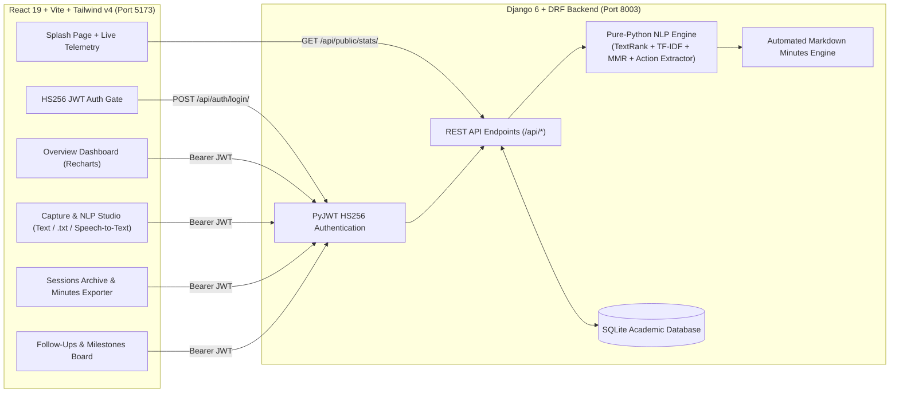

# MentorSync AI — Smart Meeting Intelligence System

> **A Django-based academic meeting intelligence platform that captures, analyzes, summarizes, and documents mentor–mentee interactions through pure-Python NLP summarization workflows and secure role-based dashboards.**

Designed and developed by **Dharshini A** (B.E. Electronics & Communication Engineering, Anna University).

---

## Key Highlights

- **Django + DRF + HS256 JWT Security**: Role-based academic profiles (`MENTOR`, `MENTEE`, `COORDINATOR`), custom `JWTAuthentication` protecting all session dashboards, and confidential record scoping.
- **Pure-Python NLP Summarization & Conversation Intelligence Engine** (`backend/meetings/nlp_summarizer.py`) — zero C/Rust build dependencies, sub-50ms execution:
  - **Multi-Speaker Transcript Parser**: Handles `Speaker [00:02:15]: text`, `[00:02:15] Speaker: text`, `Speaker: text`, and unlabelled prose with automatic Mentor/Mentee role inference.
  - **Graph-Based TextRank + TF-IDF Extractive Summarizer**: Computes sentence TF-IDF cosine similarity graphs, runs iterative PageRank centrality, applies academic discourse-marker boosts (`decided`, `milestone`, `bottleneck`, `key takeaway`), and selects non-redundant summaries via **Maximal Marginal Relevance (MMR)**.
  - **Academic Topic Clustering & Discussion Insights**: Classifies conversations across 6 academic themes (*Academics & Coursework*, *DSA & Coding Prep*, *Project Architecture*, *Research & Paper Writing*, *Career & Placement*, *Time Management & Blockers*).
  - **Decision & Actionable Follow-Up Extractor**: Automatically extracts consensus decisions and follow-up tasks with **assignee attribution (Mentor vs. Mentee)**, **priority (`HIGH`, `MEDIUM`, `LOW`)**, and **explicit/relative deadlines** (`by Friday`, `within 3 days`, `next Tuesday`).
  - **Speaker Analytics, Sentiment & Engagement Scoring**: Computes talk-time ratios, Shannon-entropy dialogue balance, question density, negation-aware lexicon sentiment, and a composite `0–100` Engagement Index.
  - **Automated Academic Minutes Generator**: Produces structured Markdown documentation live-synced with follow-up completion states — ready to preview, copy, download as `.md`, or print as PDF.
- **Investor-Grade SaaS Platform & First-Class Dark / Light Mode**:
  - **Dual-Theme Studio (`ThemeContext` + Animated `ThemeToggle`)**: Instant anti-FOUC toggle between **Obsidian Slate Dark Mode** (`#060D16`) and **Editorial Frost Light Mode** (`#F4F8FA`, crisp white glass surfaces, deep `#0F172A` ink, `#0D9488` / `#4F46E5` / `#EA580C` accents) across every dashboard, Recharts visualization, automated minutes preview, modal, and ReactBits component (`Waves`, `DotGrid`, `SpotlightCard`, `Dock`, `StarBorder`, `PillNav`, `TrueFocus`, `ShinyText`, `GradientText`, `TiltedCard`).
  - **Full SaaS Marketing Splash Page**: Sticky frosted top navbar with anchor navigation, Trusted-By academic departments marquee, live `/api/public/stats/` telemetry strip, 3-tier institutional SaaS Pricing with animated Monthly/Annual (Save 20%) toggle (`Faculty Starter`, `Department Pro` with `BorderBeam`, `University Enterprise`), Security Compliance badges, interactive FAQ accordion, and multi-column SaaS footer.
  - **Multi-Workspace Enterprise Shell**: Collapsible SaaS left sidebar with Department/Mentoring Workspace Switcher (*Anna Univ — ECE Mentoring*, *Capstone Research Group*, *Placement Mentorship Cell*), categorized navigation, live Department Pro usage quota meter, global **`Ctrl+K` / `⌘K` Command Palette**, **Live Django NLP Latency & HS256 Pill** (timed `/api/health/` ping), **Academic Intelligence Notifications Drawer**, multi-toast stack, and toggleable floating ReactBits `Dock`.
  - **Workspace Settings, Billing, API & Compliance Exports (`SaaSSettingsView`)**: Visual Dark/Light theme selector, department branding & default confidentiality policy, live metered usage bars & invoice receipts, `ms_live_*` developer API key manager & LMS/Slack webhook simulator, 1-click **Sessions CSV**, **Action Items CSV**, and **Full Academic Intelligence JSON** compliance exports, plus a timestamped Security & Session Audit Trail.
- **High-Craft React 19 + Tailwind v4 + ReactBits Frontend**:
  - **20 Custom ReactBits Components** (`src/components/reactbits/`): `Waves`, `DotGrid`, `ClickSpark`, `SplitText`, `BlurText`, `ShinyText`, `GradientText`, `DecryptedText`, `RotatingText`, `CountUp`, `TrueFocus`, `SpotlightCard`, `TiltedCard`, `Magnet`, `StarBorder`, `Dock`, `PillNav`, `AnimatedList`, `GlareHover`, and `BorderBeam`.
  - **Live Browser Speech-to-Text Capture** (Web Speech API with clean fallback), `.txt` transcript upload, and 3 one-click sample mentoring transcripts.

---

## System Architecture



---

## Quick Start (One-Click Windows Launcher)

Double-click **`start.bat`** (or run `start.bat` from Command Prompt) in the repository root. It automatically:
1. Verifies Python and Node.js are available.
2. Creates `backend\.venv` and installs `backend\requirements.txt` if missing.
3. Runs `python manage.py migrate` and the idempotent `seed_meetings` command (seeding 5 academic users, 6 realistic NLP-processed mentoring sessions, action items, and milestones).
4. Installs `frontend\node_modules` if missing.
5. Starts Django on `http://127.0.0.1:8003` and Vite on `http://localhost:5173`, waits for readiness, and opens the dashboard in your browser.

---

## Demo Credentials (Also Available as 1-Click Login Chips)

| Role | Name | Email | Password |
| :--- | :--- | :--- | :--- |
| **Faculty Mentor** | Dr. Anitha Raman (Dept. of ECE) | `mentor@mentorsync.edu` | `Mentor@123` |
| **Student Mentee** | Dharshini A (B.E. ECE · CGPA 8.2) | `dharshini@mentorsync.edu` | `Mentee@123` |
| **Coordinator** | Prof. Rajesh Subramanian | `coordinator@mentorsync.edu` | `Coord@123` |

---

## Manual Setup

### Backend (`backend/`)
```bash
cd backend
python -m venv .venv
# Windows:
.venv\Scripts\activate
# macOS/Linux:
# source .venv/bin/activate

pip install -r requirements.txt
python manage.py migrate
python manage.py seed_meetings
python manage.py runserver 127.0.0.1:8003
```

### Frontend (`frontend/`)
```bash
cd frontend
npm install
npm run dev -- --port 5173
```

---

## REST API Reference

| Method | Endpoint | Auth | Description |
| :--- | :--- | :---: | :--- |
| `GET` | `/api/health/` | Public | Service health check & indexed counts |
| `GET` | `/api/public/stats/` | Public | Anonymized aggregate telemetry for the Splash Page |
| `POST` | `/api/auth/register/` | Public | Register academic profile & issue HS256 JWT |
| `POST` | `/api/auth/login/` | Public | Authenticate via email/password & issue HS256 JWT |
| `GET` | `/api/auth/me/` | JWT | Current user profile & mentor/mentee directory |
| `GET` | `/api/dashboard/` | JWT | KPIs, longitudinal engagement/sentiment trends, topics, follow-ups & milestones |
| `GET / POST` | `/api/sessions/` | JWT | List/search role-scoped sessions or create new session |
| `GET / PATCH / DELETE` | `/api/sessions/<id>/` | JWT | Inspect full session intelligence, edit, or delete |
| `POST` | `/api/sessions/<id>/analyze/` | JWT | Run or re-run the TextRank + TF-IDF NLP workflow |
| `POST` | `/api/sessions/quick-analyze/` | JWT | Single-step create + parse + summarize pasted text or `.txt` upload |
| `GET` | `/api/sessions/<id>/document/` | JWT | Live-synced automated Markdown academic minutes & printable payload |
| `GET / POST` | `/api/action-items/` | JWT | Filterable cross-session follow-up ledger & manual creation |
| `PATCH / DELETE` | `/api/action-items/<id>/` | JWT | Transition task status (`PENDING` → `IN_PROGRESS` → `COMPLETED`) |
| `GET / POST / PATCH` | `/api/milestones/` | JWT | Academic milestone management & progress slider persistence |

---

## Publishing to GitHub

```bash
git init
git add .
git commit -m "feat: build MentorSync AI Smart Meeting Intelligence System"
git branch -M main
git remote add origin https://github.com/<your-username>/smart-meeting-intelligence.git
git push -u origin main
```

---

## Author

**Dharshini A** — B.E. Electronics & Communication Engineering, Anna University  
*Project 3: Smart Meeting Intelligence System ("MentorSync AI")*
